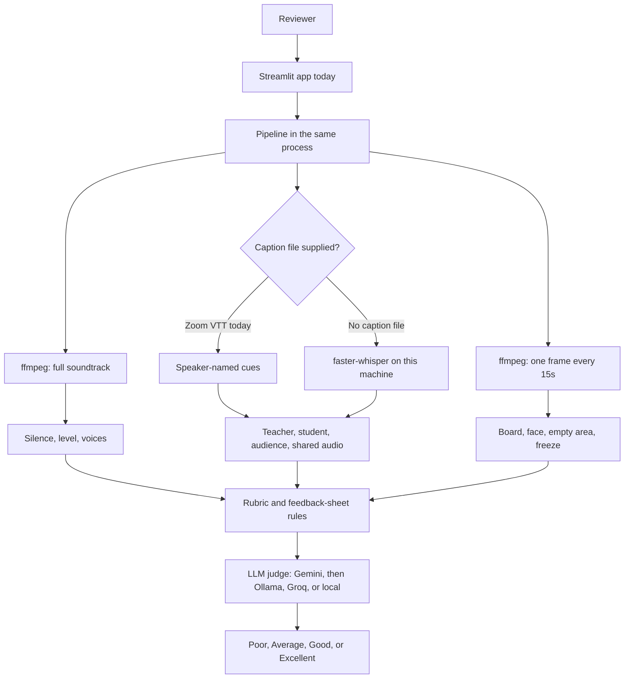
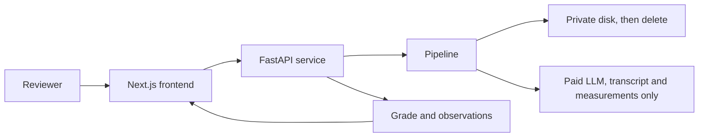

# Class quality check

A local app that grades an online class recording as **Poor**, **Average**, **Good**, or **Excellent**, and explains the grade with timestamps, speaker roles, and what was on screen.

It is built for long 8x8 chess classes (about 40–90 minutes, and it will take a 1–2 hour file). The whole soundtrack is transcribed. The screen is sampled across the whole timeline.

## What it decides

1. **Who is speaking.** Mixed audio is split into voices. Each voice is labelled teacher, student, audience, or shared lesson audio.
2. **How the class was taught.** Questions that get an answer, praise, long lectures, dead air, and broken-up teacher lines.
3. **Whether the session could be seen and heard.** Chessboard on screen, a camera in frame, empty grey panels, quiet or clipped audio, and people saying they cannot hear.

Audience means a parent, a device joining or leaving, or a voice that never takes part in the lesson. Shared audio means a video or board played through screen share. Those are not counted as students.

## Architecture

The video stays on the machine that runs the app. The judge receives a transcript sample and the measurements, not the file.

Today the reviewer uses one Streamlit process. The video stays on that machine. The judge receives a transcript sample and the measurements, not the file.



Later, the same pipeline moves behind a private API. The browser never receives the recording.



## Run it

Python 3.11+ and `ffmpeg` are required. Recordings are processed on this machine. Do not commit them, and do not point the app at a public host that stores children's video.

```bash
python3.12 -m venv .venv
source .venv/bin/activate
pip install -r requirements.txt -i https://pypi.org/simple
streamlit run app.py
```

In the app, upload a file or paste a local path or a direct download link. A Zoom `.vtt` is optional. If you provide one, real names are kept. If you do not, voices are separated from the mix.

The first run downloads the `small` speech model (a few hundred MB). A one-hour class on a laptop often takes several minutes, because the full audio is transcribed.

Command line:

```bash
python -m class_assessor "/path/to/class.mp4"
python -m class_assessor "/path/to/class.mp4" --vtt "/path/to/transcript.vtt"
python -m class_assessor --library "class recordings "
python -m class_assessor --check "class recordings "
```

`--max-minutes` truncates a file for a quick check. The default is the entire recording.

## Deploy it

### Free host now: Streamlit Community Cloud

This is the free path. No credit card. Railway's current plan is trial credit, then paid, so use it only if Streamlit Cloud runs out of memory.

The code can be public. The sample recordings and `.env` must not be in the repository. `.gitignore` already leaves them out. On the host, paste the Gemini key into the secrets box. Do not put it in the repo.

1. Create a GitHub repository and push this project. Leave out `class recordings `, `venv/`, and `.env`.
2. Sign in at [share.streamlit.io](https://share.streamlit.io) with that GitHub account.
3. Choose **Create app**. Repository: this repo. Branch: `main`. Main file path: `app.py`.
4. Open **Advanced settings → Secrets** and paste:

```toml
GEMINI_API_KEY = "your-key"
```

5. Deploy. The first boot installs `requirements.txt` and `packages.txt` (`ffmpeg`). The first assessment downloads the speech model.
6. In the sidebar, choose the **tiny** speech model. The free machine has about 1 GB of RAM. `small` often runs out of memory there. A one-hour 1080p file can also exceed the upload limit. If the app sleeps, the next open takes a minute to wake.

The public link is the app only. Uploads are processed on Streamlit's machine for that run and are not part of the GitHub repo. Do not commit a recording to make the deploy "work".

### Private machine

A 4-core VM with 8 GB of RAM is enough for one class at a time. The `small` speech model needs a few hundred MB of disk on first use, and a one-hour upload needs several GB of temporary disk. Port 8501 should not be open to the internet. Reach it through an SSH tunnel or a private network.

From a clone of this repo, with `.env` present and the sample recordings left out of the image:

```bash
docker build -t class-quality .
docker run --rm -p 127.0.0.1:8501:8501 --env-file .env class-quality
```

On your laptop:

```bash
ssh -L 8501:127.0.0.1:8501 user@your-private-vm
```

Then open `http://127.0.0.1:8501`. The container deletes the upload when the run ends. Do not mount a public bucket, and do not bake `.env` or any recording into the image.

This image is the current stack: Streamlit and the pipeline in one container. The later shape is a Next.js frontend and a FastAPI service. Next.js only uploads the file and shows the report. FastAPI owns ffmpeg, transcription, the rubric, and the judge, and it deletes the recording when the job finishes. The browser still never stores the video.

## Who judges

The written verdict comes from an LLM, in this order. A broken picture, a class that keeps stopping to ask "can you hear me", or a live back-and-forth with the teacher and the board on screen can still move the grade. The labels are only Poor, Average, Good, and Excellent. The sample folder named weak is the Poor band. A quality-issue recording is not a fifth grade: if the face is missing and the screen is frozen, or the connection keeps breaking the lesson, it cannot stay Good.

1. **Gemini** (`gemini-2.5-flash`) when `GEMINI_API_KEY` or `GOOGLE_API_KEY` is set. Override the model with `GEMINI_MODEL`.
2. **Ollama cloud** (`https://ollama.com/api/chat`) when `OLLAMA_API_KEY` is set. Default model `gpt-oss:20b`. Override with `OLLAMA_MODEL`.
3. **Groq** free tier when `GROQ_API_KEY` is set.
4. **Local Ollama** at `http://127.0.0.1:11434` if a chat model is installed (this machine has `qwen3:14b`).

Put keys in a `.env` file in the project root, or export them in the shell. The video is not uploaded. The judge receives speaker roles, measured notes, and a transcript sample spread across the whole class. If every judge fails, the report says so and keeps the measured rubric.

```bash
export GEMINI_API_KEY="your-key"
```

## How the measurements are made

Five scores, each 0–100, are given to the judge as evidence. They are not the grade by themselves:

| Part | Weight | What moves it |
| --- | --- | --- |
| Engagement | 24% | Share of time that is speech, long silences, late start, student share of talk |
| Interaction | 30% | Teacher questions, how often a student answers within 12s, praise, monologues, turn-taking |
| Clarity | 16% | Very short teacher lines, lesson vocabulary, speaking pace. Non-English audio is not punished for missing English piece names |
| Technical | 18% | Complaints about sound, level, clipping, board visible, face or camera, empty frame |
| Management | 12% | More than one student actually talking, greeting, closing, audience taking over |

Bands: 78+ Excellent, 63–77 Good, 46–62 Average, below 46 Poor. A class with almost no answers, a very long teacher-only stretch, or a soundtrack that is mostly silence cannot stay in a higher band.

## Approach (for the write-up)

Speech, voice separation, and the screen checks run locally. A language model is the judge: Gemini when a key is set, otherwise Ollama cloud, Groq, or a local Ollama model. The model sees the measured notes and a transcript sample, and it has to cite timestamps. The video file is not uploaded.

The teacher is the voice that holds the floor, asks the questions, and stays for the whole class. Students are the voices that answer. Short adult asides about wifi, mute, or joining are audience. Zoom's "audio shared" track, and long scripted turns that never take a question, are played lesson audio rather than a second teacher. Pitch is only a hint, because a woman's voice and an older child's voice can sit close together.

What separated the sample classes was not a single magic feature. Excellent classes are dialogues: speech for most of the hour, questions that get an answer, praise, and no multi-minute dead air. Weaker classes go quiet, start late, or let the teacher (or a played video) talk for minutes without a child. A "quality issue" class can still have decent teaching talk, so the screen and the level are scored on their own and written into the explanation.

Checked against `feedbacks.pdf`, the ten labelled classes match: Excellent, Good, and Average stay on those bands, Weak is reported as Poor, and a known quality issue is Average or Poor with the picture or the connection named. Every claim in the report still has a time, a speaker, or a frame rate.

Limits: voice clustering on a single mixed track will merge two similar children or stick a played video onto the teacher when Zoom did not mark it as shared audio. Screen checks are one frame every 15 seconds, so a camera that is on for a few seconds can be missed. A static chessboard is not treated as a frozen call. Non-English speech is transcribed, but the lesson-word list is English. This is a review aid for a full recording, not a perfect judge of teaching.

## Next steps

**Paid judge, so a quota does not stop a review.** The free Gemini, Groq, and Ollama tiers return 429 once a few hour-long classes are judged. Move `GEMINI_MODEL` to a paid Gemini tier, or to another paid chat API with a higher request cap, and keep the same fallback order. The video still stays on the host. Only the transcript sample and the measurements are sent.

**Shorter wait on a one-hour file.** Almost all of the time is local transcription of the mixed track. Prefer a caption file when the class already has one, and the speech model is skipped. On video-only uploads, run `small` on CPU today. A GPU host, or `tiny` when a rough pass is enough, cuts that wait. Frame sampling and the soundtrack extract can overlap. The judge call itself is a small text request at the end.

**Use the meeting transcript instead of guessing speakers.** Zoom `.vtt` is already accepted and keeps real names. Teams and Google Meet export the same kind of speaker-labelled transcript (Teams `.vtt` or `.docx`, Meet transcript export). Those cues are the right input: the teacher, each child, and a parent are already named, so the app does not have to separate them from one mixed recording. Wire those exports through the same caption path, and keep faster-whisper only for a file that has no transcript.

**Check the metrics on classes the sheet did not tune.** Engagement, interaction, clarity, technical, and management already produce a number, and the ten labelled files match `feedbacks.pdf`. That match was fit on those same files. Hold one class out, score it, and compare each subscore with the note on the sheet (rapport, homework, light, camera, connection) before trusting the weight. A new recording from the organisers is the real check.

**Transcription works, and it is still the weak step.** A Zoom caption file keeps names. A video with no caption goes through faster-whisper on the mixed track: one voice channel, chess words in the prompt, and a local wav so the decoder does not depend on PyAV. That pass still merges similar children, glues a played video onto the teacher, and drops or invents lines on a noisy hour. Prefer the Teams or Meet transcript when it exists. When it does not, move to a diarised speech model with word times, keep the chess prompt, and reject repeated hallucinated lines before they reach the judge.

**A tighter brief for the judge.** The model already has to return Poor, Average, Good, or Excellent, with a short summary and five or six observations that cite a time and a name from the evidence. The next brief should make the result follow the sheet in plain language: who led, whether students answered, whether homework was set, and whether the camera, the board, or the connection got in the way. It should refuse a Good or Excellent label when the evidence shows a missing face, a frozen picture, or repeated "can you hear me". Measured numbers stay evidence. The written result should still stand on its own if the model is swapped for a paid one.

## Tests

```bash
python -m unittest tests.test_assess -v
```

## Privacy

Sample recordings and transcripts in `class recordings ` contain children. They are gitignored. Transcription stays on this machine. The judge call sends the transcript text and measurements, not the video. Delete Streamlit temp files and the Hugging Face model cache if you need to wipe downloaded speech weights (`~/.cache/huggingface`). Do not commit `.env`.
